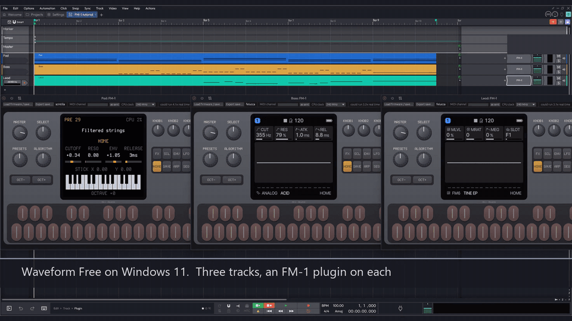

# FM-1 emulator

The **M-VAVE FM-1** is a pocket FM synthesizer, and a small community writes its own firmwares
for it: drum machines, grooveboxes, ambient generators, a chord harp. This project emulates the
FM-1 itself, its CPU, screen, keys, knobs and audio, so every one of those firmwares runs
unchanged in a browser, on a computer or as an instrument plugin in a DAW (AU, VST3). You can
try a firmware before you install it, write one without a synth on the desk, or just play.

**Play it: [joakimeriksson.github.io/fm1-emu](https://joakimeriksson.github.io/fm1-emu/)**:
pick a firmware, press Start, play with the computer keyboard, the mouse, a touch screen or
a MIDI keyboard.

[](https://joakimeriksson.github.io/fm1-emu/)

With sound: nine of the firmwares in 50 seconds.

https://github.com/user-attachments/assets/6849316e-7239-497e-b617-be74317dc2b1

The browser keeps the firmware you run and automatically saves flash changes, including settings
and patches saved through the firmware's own controls. Each exact firmware version has its own
save. **Save & backup** offers a manual save, portable `.fm1save` backup export/import, reset,
and a check for firmware updates. This also works with locally opened packages and on the
SMK-37 page. Edits held only in firmware RAM need its normal save command first; browser saves
survive reloads but clearing browser data removes them. Export a backup to keep a separate copy.

The page hosts no firmware: it downloads each one from its author's own site when you start
it, the same update package you would install on a real FM-1. M-VAVE's own firmware can't be
fetched that way, so download `FM-1.fwsc` from M-VAVE and open it on the page.

And the **[M-VAVE SMK-37](https://joakimeriksson.github.io/fm1-emu/smk37/)**: a 37-key keyboard with
the FM-1's chip inside, whose community ports run here too ([below](#the-smk-37)).

Also here: **[FM-1 SID](https://github.com/joakimeriksson/fm1-sid)** (`fm1-sid/`, a submodule: clone with
`--recurse-submodules`), a firmware that turns the FM-1 into a Commodore 64 SID
synth, with a step sequencer and stereo chorus, delay and reverb, that also plays C64 tunes
and GoatTracker songs ([its page](https://joakimeriksson.github.io/fm1-emu/fm1-sid/) plays all of HVSC).
On a real FM-1 it is its own firmware on [fm1-dock](https://github.com/joakimeriksson/fm1-dock), which
keeps USB, the installers and the rescue.

## What runs

The community firmwares: every one on [the FM-1 Firmware Hub](https://thefirmwarehub.com/) that
runs here (its packages, fetched from the Hub; `tools/hub_catalog.mjs` follows its catalog), and a
few more from [fm1-editor.com/firmware](https://fm1-editor.com/firmware/). Also FM-1 SID, and
M-VAVE's stock firmware (V13 and V15) with both CPU cores running. The ones the Hub doesn't list
are our own list, `web/firmwares-own.json`: add a firmware there, and the tool appends it. The page
also lists, last and marked as not yet run here, whatever else the Hub has a package for, so a new
firmware is playable the day it is published. **The list, each firmware with its author and a
link that opens it on the page: [docs/FIRMWARES.md](docs/FIRMWARES.md).** (`?fw=` takes the Hub's ids
too; `&embed=1` shows only the device and its controls, for a window on another site;
`?package=URL` plays a package from another site (https, with CORS on) that the list doesn't have,
`&name=` naming it: other hubs' "Try", older versions; `?chip=uc25hq80` gives the FM-1 the flash
part of units sold since autumn 2026, JEDEC B3 60 14, in place of the stock Puya, as fm1-live's
`--flash-chip uc25hq80` does: a firmware that knows only the Puya keeps its saves in RAM there.)
A page on this site can hand the emulator a try-out (`web/tryout.js`): `&flash=PATH` lays flash
sectors over the package's fresh flash (records of a 4-byte little-endian offset and the 4096-byte
sector, as the saves keep them), `&script=PATH` plays an input script from the boot (fm1-live's
`FM1_BENCH_KEYS`: `ms:mHEX` MIDI into the DIN jack, `ms:id` keys, `ms:eN:clicks` encoders). Both
come from the page's own origin only, the try-out starts by itself where the browser lets it, and
it is a session of its own: the browser's saved flash is neither loaded nor overwritten. fm1-dock's
catalog uses it for its "Try it": a module installed and picked
([fm1-dock's tools/tryit.py](https://github.com/joakimeriksson/fm1-dock/blob/main/tools/tryit.py)).


MIDI in works through the emulated MIDI IN jack, so each firmware reads MIDI with its own
driver: Web MIDI on the page (Chrome, Edge, Firefox), any MIDI input natively. M-VAVE's
firmware listens on channel 2 in the emulator (not yet checked on a real FM-1); Felucca plays
its parts on channels 1–4.

## The SMK-37

M-VAVE's SMK-37 (Pro / Elite, the MKE-P37 and the Donner Starrykey 37 Play share its hardware) is a
37-key keyboard with 16 RGB pads, 8 knobs, 4 faders, pitch and mod wheels and a screen, around the
FM-1's chip: same flash layout, audio and update path, only the panel is wired differently.
genkigenki's [fm1-to-smk37](https://github.com/genkigenki/fm1-to-smk37) kit maps that wiring and
ports FM-1 firmwares to it. The emulator models the SMK-37's panel from that map, and a package's
identity says which board it runs on.

**Play it: [joakimeriksson.github.io/fm1-emu/smk37](https://joakimeriksson.github.io/fm1-emu/smk37/)**.
The firmwares come from [genkigenki's install page](https://genkigenki.github.io/smk37/)
(`node tools/smk37_catalog.mjs` refreshes the list). M-VAVE's own SMK-37 firmware runs as the
MIDI controller it is (screen, buttons, pads, keys; it names the chord you hold): with PATCH on, the
keys play its DX7 synth from this emulator's own bank (the factory patches are not in the package; the
notes also go to USB / Bluetooth MIDI), slower than real time in the browser so far.

Its firmwares, each with its author: [docs/FIRMWARES.md](docs/FIRMWARES.md#the-smk-37).

## On your computer

**Download** `fm1-live` for macOS (Apple silicon) or Linux (ARM64, x86-64) from
[the releases](https://github.com/joakimeriksson/fm1-emu/releases/latest), and play a firmware
package: `./fm1-live --fwsc felucca.fwsc`. Or build it from a checkout:

```sh
cargo run --release -p fm1-live -- --fw list           # the firmwares
node tools/fetch_firmwares.mjs                          # download them into reference/firmwares
cargo run --release -p fm1-live -- --fw felucca         # a window with the synth, audio out
cargo run --release -p fm1-live -- --fwsc FM-1.fwsc     # M-VAVE's own, from its package
```

`fm1-live` compiles the firmware to native code on Macs (Apple silicon and Intel), on Linux (ARM64
and x86-64) and on Windows (x86-64), and runs the real 240 MHz clock with it; elsewhere it interprets
(`--mhz` lowers the clock if that can't keep up). It plays every MIDI input of the computer (`--midi NAME`, `--midi none`,
`--midi-ch N`) and loads a DX7 bank into M-VAVE's firmware with `--syx bank.syx`.
`fm1-emu` is the batch runner for tests and debugging (WAV and screen output, breakpoints,
memory dumps).
Both take `--flaky-core1 RATE [--seed N]`: the second core misreads RAM now and then, as on
some units, to test a firmware's fallback to one core ([docs/stock-firmware.md](docs/stock-firmware.md#a-flaky-core-1---flaky-core1-fm1_socflaky)).
`fm1-live --flash FILE` keeps the flash chip (saved presets, samples) in FILE between runs: read
at the start if it is there, written back at the end. `FM1_FLASH_CUT=N` cuts the power half way
through the Nth erase or page program, to see what a firmware makes of a half-written save.
`fm1-live --usb` plugs in a USB cable: the FM-1's USB controller answers (without it, it stays
silent, as on a unit with no cable), a host enumerates it, and a USB-MIDI firmware shows up on the
computer (macOS and Linux; on Windows the bus runs, but no MIDI device appears) as a MIDI device
"<its product name> (emu)" that any program can play or talk to, Felucca's `fm1_install.py`
included. It goes away when the firmware drops off USB. The controller supports both polling
(Felucca) and interrupts (FM-1 Sampler). Headless, `--shot` with
`FM1_USB_SEND='MS:HEX;…'` sends MIDI over USB at those times and prints what comes back
(`FM1_USB_TRACE`: the bus's transactions; `FM1_USB_SIE_NS`: the controller's register access time,
an estimate, 1 µs by default).
USB audio: with `FM1_USB_WAV=FILE` (`--bench` or `--shot`) the host also records the firmware's
USB audio input as a computer's recording program would: it chooses the audio streaming
interface's setting that has the isochronous endpoint, asks for `FM1_USB_RATE` (44100 by
default) if the endpoint can be set to it and the format offers it (else the device's own rate),
takes one packet a millisecond and writes the samples to FILE (16-bit, interleaved as the device's
channels come, no header), printing how many packets came empty (nothing queued: an underrun).
Realistic mode: by default the emulator is generous where an FM-1 is not, so firmwares boot and
play as they always have here. `FM1_STRICT=1` (fm1-live) runs it as an FM-1 is: a misaligned 16- or
32-bit RAM access faults, each instruction takes its measured cycles (both cores, the flash
cache's misses, the HW DSP / EQ / SRC units' jobs), and the LCD's transfers take their time at
the SPI clock (a 240 x 240 frame ~77 ms at 12 MHz), so a firmware whose main loop waits for whole
frames gets as little done in between as on the device; it interprets, without the JIT, so it
is slower. `FM1_LCD_TIMED=1` (fm1-live, fm1-emu) times the LCD alone; `FM1_LCD_INSTANT=1` keeps it
instant under `FM1_STRICT`. A firmware that boots under it boots later (its first frames take
their time). `fm1-live --shot` then reports the LCD's share of the run.

The page builds with `web/build.sh` (Rust to WebAssembly; needs the `wasm32-unknown-unknown`
target), the whole site with `tools/build_site.sh`.

## In your DAW: AU and VST3

The emulator also comes as an **instrument plugin**, so a firmware plays in a DAW like any
other synth:

| Format | Loads in |
|---|---|
| **AU** | Logic Pro, GarageBand, MainStage, and most other Mac DAWs |
| **VST3** | Ableton Live, Cubase, FL Studio, Reaper, Bitwig, Studio One, Cakewalk… |
| **CLAP** | Bitwig, Reaper, FL Studio, Studio One… |

**What it does:**
- **The firmware:** **Load firmware / save…** in the plugin’s window picks a `.fwsc` package: any
  community firmware ([docs/FIRMWARES.md](docs/FIRMWARES.md) links each author's) or M-VAVE's own. An SMK-37 package
  gets the SMK-37's panel.
- **Playing it:** MIDI from the DAW plays it, as through the FM-1's MIDI IN. A *MIDI channel*
  setting moves all notes to one channel; M-VAVE's firmware listens on 2. The panel is the
  page's, played with the mouse: keys, buttons, knobs, and on the SMK-37 the pads, faders and
  wheels.
- **Automation:** *Master* (the MASTER pot) is a parameter the DAW can automate.
- **CPU clock:** the emulated clock, 240 MHz as on the chip by default. 120 or 160 let a heavy
  firmware keep up on a slower computer; 320 or 400 give a firmware that runs out of time more,
  at the cost of more of the computer's CPU.
- **Share setups with the browser or another DAW.** “Load firmware / save…” opens a `.fwsc`
  package or `.fm1save` setup. “Export save…” writes the firmware and its latest saved patches
  and settings to one portable file. Edits in RAM need the firmware’s own Save command first.
- **The project keeps the firmware and its patches.** The package and every flash sector the
  firmware has written are saved with the song, so it reopens with the same sounds.
- **Timing:** the emulator runs a little ahead of the DAW and reports that delay as the plugin's
  latency, so the DAW compensates and notes land where they were placed. The status bar shows
  how much faster than real time the firmware could run on this computer; most run at 3–6x,
  the heaviest at about 1.5x.

**Download it** from [the releases](https://github.com/joakimeriksson/fm1-emu/releases/latest):
a zip for Macs with Apple silicon (M1 or later; AU, VST3 and CLAP) and one for Windows (x86-64;
VST3 and CLAP). Each has an `INSTALL.txt` that says where the files go. Until a release is signed
with an Apple Developer ID, macOS blocks it until you allow it, with one Terminal command that
`INSTALL.txt` gives; the Windows build is unsigned too, and Windows hosts load it as it is.

**Build and install it yourself (macOS, Apple silicon).** You need Rust, CMake and Ninja
(`brew install cmake ninja`), then:

```sh
tools/build_plugin.sh
```

This builds the plugin and installs `FM-1.component`, `FM-1.vst3` and `FM-1.clap` in
`~/Library/Audio/Plug-Ins`. It then runs Apple's AU validator on them.

**Build and install it yourself (Windows, x86-64).** You need Rust (MSVC), Visual Studio Build
Tools with the C++ workload, CMake and git, then:

```powershell
tools\build_plugin.ps1
```

This builds `FM-1.vst3` and `FM-1.clap` and installs them in `%LOCALAPPDATA%\Programs\Common`
(`VST3` and `CLAP`). The two go together: the VST3 loads the CLAP from the CLAP folder.
[crates/fm1-plugin](crates/fm1-plugin/README.md) has the details, and where to put them for a
DAW that only scans `C:\Program Files\Common Files`.

**In GarageBand:**
1. *Settings → Audio/MIDI*: tick *Enable Audio Units*, then quit and reopen GarageBand.
2. Make a *Software Instrument* track and open its Smart Controls (**B**).
3. Click the *Instrument* slot and choose *AU Instruments → fm1-emu → FM-1*.
4. Click the slot to open its window, then *Load firmware / save…*.
5. Play it with **⌘K** (Musical Typing) or a MIDI keyboard.

**In Logic:** a Software Instrument track's instrument slot, *AU Instruments → fm1-emu → FM-1*.

**In VST3 or CLAP hosts:** add *FM-1* (by fm1-emu) as an instrument on a track.

**On Windows, in Waveform Free** (REAPER works the same way; both find the plugin in
`Common Files` and in the per-user folders, where the release's `INSTALL.txt` and
`tools\build_plugin.ps1` put it):

[](docs/media/plugin-windows-waveform.gif)

1. *Track → Create New Track*, then the **+** at the right end of the track: *Plugins → fm1-emu → FM-1*.
2. Click the *FM-1* box on the track to open its window, then *Load firmware / save…* and pick a
   `.fwsc` package.
3. Play it from a MIDI keyboard, or click the panel's keys. A MIDI clip on the track plays it too.

The clip above is three tracks at 100 BPM, each with its own FM-1: a pad on
[Scintilla](https://github.com/joakimeriksson/scintilla-fm1) (an Elka Synthex; preset 29,
*Filtered strings*), then a bass and a lead joining on Felucca (*Analog Acid* and *FM6 Tine
EP*). Each window's status bar shows the headroom: on a laptop each instance could run at about
3x real time with all three playing, 4.5x idle. FM-1 Dock, which runs both of the chip's cores, is the
heaviest: under real time on that laptop even at 120 MHz, so a synth it carries as a module is
lighter as its own firmware, as Scintilla is here.

**How it's built:** it's one plugin written in Rust as a CLAP with
[nih-plug](https://github.com/robbert-vdh/nih-plug). [clap-wrapper](https://github.com/free-audio/clap-wrapper)
makes the AU and VST3 of it, and the plugin stays MIT. All its parts are MIT, ISC or Apache-2.0,
including Apple's AudioUnitSDK and Steinberg's VST3 SDK, which is MIT since 3.8.

**So far it has passed:**
- Apple's AU validator (`auval`);
- Steinberg's VST3 validator (47 of 47 tests);
- GarageBand, as an AU;
- Steinberg's VST3 test host.

On Windows the VST3 passes Steinberg's validator too (47 of 47) and plays in REAPER and
Waveform Free. Logic, Ableton and the Linux build haven't been tried yet. More in
[crates/fm1-plugin](crates/fm1-plugin/README.md).

## How it works

The FM-1 is built on a JieLi AC791N: two cores of JieLi's own 32-bit pi32v2 CPU, with no
public instruction set manual. The instruction set here was recovered from the firmwares
themselves (`isa/`, `docs/isa-notes.md`) and checked against test programs built with JieLi's
toolchain. On top of the CPU sit models of the chip's timers, interrupts, flash, the
240×240 screen, the key matrix and encoders, the knobs, the audio output and the MIDI UART.
Hot code is compiled, to AArch64 natively and to WebAssembly in the browser.
How it was built and checked, step by step, is told in a technical report:
[Emulating a Synthesizer Before It Arrives](https://joakimeriksson.github.io/fm1-emu/fm1-emu-report.pdf)
(PDF, 12 pages), with a section on the real FM-1: what releasing FM-1 SID before it ran on one cost
its first users, the rounds that made it work there, and what fm1-dock's probes measured on the chip.

- `crates/`: `fm1-isa` (decoder tables), `fm1-core` (CPU and JITs), `fm1-soc` (the chip and
  the board), `fm1-live` (the native synth), `fm1-emu` (batch runner), `fm1-web` (the wasm
  build), `fm1-gdbstub`
- `web/`: the page; `web/fwsc.js` unpacks the update packages
- `docs/`: the hardware notes (`recon.md`), the instruction set (`isa-notes.md`), M-VAVE's
  firmware (`stock-firmware.md`); `PLAN.md` is the work log
- `tools/`, `probes/`: ISA extraction, benchmarks, differential test programs
- `fm1-sid/`: the SID study and player firmware, [joakimeriksson/fm1-sid](https://github.com/joakimeriksson/fm1-sid) as a submodule
  (its own README; `git submodule update --init` after a plain clone)

## Licences

The emulator is MIT (`LICENSE`). The firmwares are their authors' and are not part of this
repository; the page fetches them from the authors' sites. `fm1-sid/` (its own repository) has
files under other licences, among them its player firmware, GPL-3.0 since it is built on
Felucca's code: its LICENSING.md lists them. The plugin (`crates/fm1-plugin`) is MIT too; the libraries and SDKs it
builds with are permissive: MIT, ISC, Apache-2.0, BSD, Zlib, BSL-1.0, Unicode-3.0 and Unlicense, egui's built-in
fonts OFL-1.1 and the Ubuntu font licence, and Steinberg's VST3 SDK (3.8, through clap-wrapper) MIT. nih-plug is built
without its VST3 bindings, which are GPL. What the emulator emulates it learned from the chips' behaviour, the
community's reverse engineering and the firmwares' own sources as references; no GPL code is in this repository
(the test probe `probes/x0x/d909.c` builds X0X's GPL drum against it from a checkout outside it).

## Credits

Built on the community's reverse engineering of the FM-1:
[AL-255/FM-1-RE](https://github.com/AL-255/FM-1-RE),
[ip2k/lunar-modulator](https://github.com/ip2k/lunar-modulator),
kagaimiq's [jielie](https://kagaimiq.github.io/jielie), the hardware layer of
[hugelton/Felucca](https://github.com/hugelton/Felucca) and
[awesome-fm-1](https://github.com/cicloid/awesome-fm-1). Thanks to every firmware author for publishing their work.
