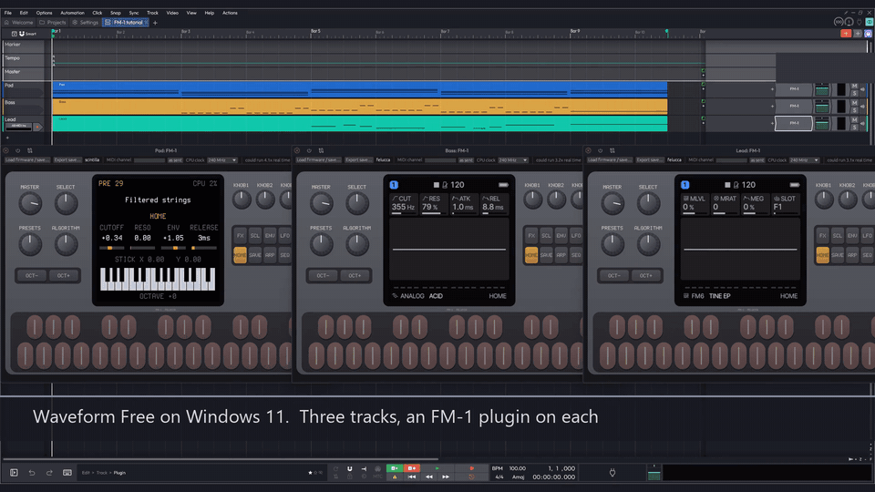

# FM-1 emulator

The **M-VAVE FM-1** is a pocket FM synthesizer, and a small community writes its own firmwares
for it: drum machines, grooveboxes, ambient generators, a chord harp. This project emulates the
FM-1 itself, its CPU, screen, keys, knobs and audio, so every one of those firmwares runs
unchanged in a browser, on a computer or as an instrument plugin in a DAW (AU, VST3). You can
try a firmware before you install it, write one without a synth on the desk, or just play.

**Play it: [joakimeriksson.github.io/fm1-emu](https://joakimeriksson.github.io/fm1-emu/)**:
pick a firmware, press Start, play with the computer keyboard, the mouse, a touch screen or
a MIDI keyboard.

[](https://joakimeriksson.github.io/fm1-emu/)

With sound: nine of the firmwares in 50 seconds.

https://github.com/user-attachments/assets/6849316e-7239-497e-b617-be74317dc2b1

The browser keeps the firmware you run and automatically saves flash changes, including settings
and patches saved through the firmware's own controls. Each exact firmware version has its own
save. **Save & backup** offers a manual save, portable `.fm1save` backup export/import, reset,
and a check for firmware updates. This also works with locally opened packages and on the
SMK-37 page. Edits held only in firmware RAM need its normal save command first; browser saves
survive reloads but clearing browser data removes them. Export a backup to keep a separate copy.

The page hosts no firmware: it downloads each one from its author's own site when you start
it, the same update package you would install on a real FM-1. M-VAVE's own firmware can't be
fetched that way, so download `FM-1.fwsc` from M-VAVE and open it on the page.

And the **[M-VAVE SMK-37](https://joakimeriksson.github.io/fm1-emu/smk37/)**: a 37-key keyboard with
the FM-1's chip inside, whose community ports run here too ([below](#the-smk-37)).

Also here: **[FM-1 SID](https://github.com/joakimeriksson/fm1-sid)** (`fm1-sid/`, a submodule: clone with
`--recurse-submodules`), a firmware that turns the FM-1 into a Commodore 64 SID
synth, with a step sequencer and stereo chorus, delay and reverb, that also plays C64 tunes
and GoatTracker songs ([its page](https://joakimeriksson.github.io/fm1-emu/fm1-sid/) plays all of HVSC).
On a real FM-1 it is its own firmware on [fm1-dock](https://github.com/joakimeriksson/fm1-dock), which
keeps USB, the installers and the rescue.

## What runs

81 community firmwares: every one on [the FM-1 Firmware Hub](https://thefirmwarehub.com/) that
runs here (its packages, fetched from the Hub; `tools/hub_catalog.mjs` follows its catalog), and a
few more from [fm1-editor.com/firmware](https://fm1-editor.com/firmware/). Also FM-1 SID, and
M-VAVE's stock firmware (V13 and V15) with both CPU cores running. The ones the Hub doesn't list
are our own list, `web/firmwares-own.json`: add a firmware there, and the tool appends it. Each
name below opens the page with that firmware picked; press Start. (`?fw=` takes the Hub's ids
too; `&embed=1` shows only the device and its controls, for a window on another site.)
A page on this site can hand the emulator a try-out (`web/tryout.js`): `&flash=PATH` lays flash
sectors over the package's fresh flash (records of a 4-byte little-endian offset and the 4096-byte
sector, as the saves keep them), `&script=PATH` plays an input script from the boot (fm1-live's
`FM1_BENCH_KEYS`: `ms:mHEX` MIDI into the DIN jack, `ms:id` keys, `ms:eN:clicks` encoders). Both
come from the page's own origin only, the try-out starts by itself where the browser lets it, and
it is a session of its own: the browser's saved flash is neither loaded nor overwritten. fm1-dock's
catalog uses it for its "Try it": a module installed and picked
([fm1-dock's tools/tryit.py](https://github.com/joakimeriksson/fm1-dock/blob/main/tools/tryit.py)).

<!-- firmwares: node tools/readme_firmwares.mjs -->
| Firmware (opens it on the page) | By | What it is |
|---|---|---|
| [M-VAVE stock firmware](https://joakimeriksson.github.io/fm1-emu/?fw=mvave) | [M-VAVE](https://github.com/joakimeriksson/fm1-emu/blob/master/docs/stock-firmware.md) | The firmware the FM-1 ships with: a DX7-style FM synth, both cores running. Bring your own `FM-1.fwsc`. |
| [Felucca 1.6.1](https://joakimeriksson.github.io/fm1-emu/?fw=felucca) | [hugelton](https://github.com/hugelton/Felucca) | The original open firmware: a four-operator FM synth with sequencer, arpeggiator and effects. |
| [Felucca [Salt] 0.9-salt14](https://joakimeriksson.github.io/fm1-emu/?fw=felucca-salt) | [ChanceTheMaker](https://github.com/ChanceTheMaker/Felucca) | A Felucca fork with its own sound and editor changes. |
| [386DX 1.0.2](https://joakimeriksson.github.io/fm1-emu/?fw=386dx) | [seajaysec](https://github.com/seajaysec/386-DX-FM1-KaraokeBot) | A karaoke robot with a band: it sings songs from karaoke and MIDI files, or lines you type, to the notes you play. |
| [AMB-1 1.3](https://joakimeriksson.github.io/fm1-emu/?fw=amb) | [charlesvestal](https://github.com/charlesvestal/fm1-amb) | A generative ambient machine inspired by Music for Airports. |
| [April OS BETA 1.1](https://joakimeriksson.github.io/fm1-emu/?fw=april) | [beashoko](https://github.com/beashoko/april-os) | A sampler inspired by the Casio SK-1: no synth engines, only samples, recorded through the installer page's microphone bridge. |
| [BEETLE 1.4.25](https://joakimeriksson.github.io/fm1-emu/?fw=beetle) | [Joppe Sikken (SikkenWorks)](https://github.com/SikkenWorks/BEETLE) | A tracker for the FM-1: patterns written top to bottom, step by step, with note, instrument, chord and effect columns, the way trackers have always worked. |
| [Bunker Evolved 1.0.0](https://joakimeriksson.github.io/fm1-emu/?fw=bunker) | [Kid Bunka](https://github.com/kidbee85-beep/bunker-evolved) | Generative ambient: four editable layers from 64 sound recipes, 24 worlds, 24 motifs and 32 scales. |
| [Bytemania 1.2.0](https://joakimeriksson.github.io/fm1-emu/?fw=bytemania) | [lloyd (llozd)](https://github.com/llozd/bytemania) | A bytebeat synth: play one-line formulas, tweak them with the knobs, and write your own, with a random button in the formula creator that is really fun. |
| [Carnac OS 0.9.3](https://joakimeriksson.github.io/fm1-emu/?fw=carnac) | [OrbVorgis](https://github.com/OwenKirby/carnac-os) | A dual-timbral wavetable synth after Carnac's standing stones: 15 morphing wavetable banks, seven voice architectures, a MAQ 16/3-style sequencer for modulated sequences and a chord sequencer for progressions, spring, tomb and tank reverbs. |
| [Chipbox 1.2.4](https://joakimeriksson.github.io/fm1-emu/?fw=chipbox) | [Pasquale Barilla](https://github.com/pbarilla/chipbox) | A chiptune groovebox with replicas of the NES, Game Boy and Sega Master System sound chips, in three views: RACK for the 16 steps of a page, CHIP to set up each channel, SONG to chain the pages into a song. |
| [ChoralRoot 0.26.1](https://joakimeriksson.github.io/fm1-emu/?fw=choralroot) | [Quixotic7](https://github.com/Quixotic7/ChoralRootFM1) | A port of the Choral Root synth. |
| [fm1-chord 0.3](https://joakimeriksson.github.io/fm1-emu/?fw=chord) | [math0ne](https://github.com/math0ne/fm1-chord) | A chord machine after the HiChord, with extras: chords in a key under the white keys, slash chords and inversions, sounds, envelopes, effects and a looper. |
| [Clipper 1.1-experimental](https://joakimeriksson.github.io/fm1-emu/?fw=clipper) | [isod89](https://github.com/isod89/clipper-fm1) | A deep synth grown out of SLOOP: 23 engines and 407 sounds, from HYBRID (three oscillators, two filters, a mod matrix) to six-operator FM, wavetables, wave sequencing, a Juno and physical models; arp, step sequencer, MPE and a web editor for every parameter. |
| [CoralFlower 0.5](https://joakimeriksson.github.io/fm1-emu/?fw=coralflower) | [FicusFicusov](https://github.com/FicusFicusov/CoralFlower) | Chords after the Orchid, with a UX made for the FM-1: one key turns every note into a chord with a bass, 27 scales, an arpeggiator, a looper, a plate reverb, and a pixel flower that grows as you play. |
| [CS-1 2026.10.22](https://joakimeriksson.github.io/fm1-emu/?fw=cs1) | [twochannels](https://github.com/twochannels/CS-1) | A Yamaha CS-80 in spirit: eight voices of two channels, high- and low-pass filters in series, ring modulator, the touch response and 22 tones from the owner's manual. |
| [CTL-1 1.0](https://joakimeriksson.github.io/fm1-emu/?fw=ctl) | [charlesvestal](https://github.com/charlesvestal/fm1-ctl) | A MIDI controller: the keys play in a scale with its chords on the black keys, four banks of knobs, an arpeggiator and Euclidean drums, with General MIDI sounds of its own. |
| [Cut-A-Dor 1.2.1](https://joakimeriksson.github.io/fm1-emu/?fw=cutador) | [Kid Bunka](https://github.com/kidbee85-beep/cut-a-dor-release) | A beat dojo for scratch DJs and beatmakers: boom bap, lo-fi and breaks from 16 rhythm families with swing and fills, an eight-lane 32-step sequencer, punch-in effects you record bar by bar, a bass voice. |
| [Del Rio 0.7](https://joakimeriksson.github.io/fm1-emu/?fw=delrio) | [Jess Del Rio](https://github.com/jsopdebeeck/fm1-delrio) | A rhythm box of ceremony percussion: djembe, cajon, udu, clapsticks, maracas and triangle, their real strokes on the black keys, a step sequencer on the white keys and 31 rhythms from the literature. |
| [Dinghy 0.4](https://joakimeriksson.github.io/fm1-emu/?fw=dinghy) | [zvenson](https://github.com/zvenson/dinghy) | Your base for your own FM-1 firmware: everything under it done and documented (updates, USB rescue, USB-MIDI, USB audio, keys, screen, settings), a 4-voice sine on top. |
| [DRIFT 0.8](https://joakimeriksson.github.io/fm1-emu/?fw=drift) | [FBNFRTG](https://github.com/FBNFRTG/drift-fm1) | An ambient instrument for live sessions: warm synths, spacious pads and delicate plucks over a generative Euclidean sequencer on one track, with delays and reverbs from spring to shimmer. |
| [DUB-1 1.3.0](https://joakimeriksson.github.io/fm1-emu/?fw=dub) | [sbegueria](https://github.com/sbegueria/fm1-dub) | A generative dub techno machine that plays itself from the moment it is on: chord stabs into a tape echo, FM pings, a sub bass on five grooves, a ducking kick, crackle, and an eight-bar arrangement with breaks and fills. |
| [DUELL 1.0](https://joakimeriksson.github.io/fm1-emu/?fw=duell) | [OSCILL/R](https://github.com/oscillr/DUELL) | A multimorphing bitimbral synthesizer: two complete parts, three ways to play them together, and a morph that glides between two versions of every sound. |
| [Evander's Music Box 1.5.2](https://joakimeriksson.github.io/fm1-emu/?fw=emb) | [Michail Tsakiroglou](https://github.com/MikeTsak/Evanders-Music-Box--FM-1-LARP-firmware) | A bard's instrument for LARP, medieval and high fantasy: recorder, hurdy-gurdy, harp and a tavern kit on four tracks, encounters and songs for the table. |
| [ETCH 1.61](https://joakimeriksson.github.io/fm1-emu/?fw=etch) | [SikkenWorks](https://github.com/SikkenWorks/ETCH) | Draw the sound: a waveform drawn and changed with the knobs, morphed into another one, and a third modulating the result. |
| [Fart Machine One 1.1.0](https://joakimeriksson.github.io/fm1-emu/?fw=fart) | [adamcharleswilsonmusic-code](https://github.com/adamcharleswilsonmusic-code/Fart-Machine-One) | A questionable musical instrument: eleven artisanal farts, reverb, delay and a sixteen-step sequencer. |
| [Felucca 8 Patterns 1.6.1_and_sequences](https://joakimeriksson.github.io/fm1-emu/?fw=felucca8) | [echoe](https://github.com/echoe/Felucca_8_patterns) | Felucca 1.5.1 with eight sequences a track to switch between and chain one after another; the user samples are left out to make room. |
| [FiMba-1 0.6.1](https://joakimeriksson.github.io/fm1-emu/?fw=fimba) | [jadamsowers](https://github.com/jadamsowers/fm1-fimba) | A physically modelled kalimba (thumb piano), with mbira patterns, tape and grains. |
| [Flyfish 1.0.1-4e5efb8](https://joakimeriksson.github.io/fm1-emu/?fw=flyfish) | [delirioux](https://github.com/delirioux/flyfish) | One piece on the FM-1: Chopin's Étude Op. |
| [FM-106 Beta4](https://joakimeriksson.github.io/fm1-emu/?fw=fm106) | [PatttF](https://github.com/PatttF/fm-106) | The Juno-106 emulation of KR-106 ported to the FM-1: six voices on both cores, the BBD stereo chorus, 128 factory presets and a 1980s Roland look. |
| [fm1-dock 0.7](https://joakimeriksson.github.io/fm1-emu/?fw=fm1dock) | [joakimeriksson](https://github.com/joakimeriksson/fm1-dock) | One firmware, many synths: CS-1, Scintilla and OberVave as modules in flash, the sine built in; HOME opens the picker. |
| [FM-1 Doom 0.5](https://joakimeriksson.github.io/fm1-emu/?fw=fm1doom) | [zvenson](https://github.com/zvenson/fm1doom) | Doom on the FM-1: one arena from FreeDM, played on the keys and a knob, on the FM-1's screen, with synthesised sound effects and no music. |
| [FM1-GM 1.0.2](https://joakimeriksson.github.io/fm1-emu/?fw=fm1gm) | [jartificer](https://github.com/jartificer/fm1-gm) | A General MIDI sequencer with 16 tracks, 128 General MIDI instruments to choose from and a drum kit (on track 10). |
| [FMEL-1 1.0](https://joakimeriksson.github.io/fm1-emu/?fw=fmel) | [Antonio Altea](https://github.com/AntonioAltea/fmel-1) | Mellotron-style tape sounds, coloured with effects and lo-fi tape: flutes, strings and choirs as on the old tape frames, played from the keys. |
| [FMini-1 1.8.0](https://joakimeriksson.github.io/fm1-emu/?fw=fmini) | [Ruppert](https://github.com/ruppert/fmini-1) | A three-oscillator monosynth in the spirit of the classic Moogs: a 24 dB/octave ladder filter, two contours, 100 factory patches, an arpeggiator, a sequencer and MIDI. |
| [FOMAJAM 0.1.6](https://joakimeriksson.github.io/fm1-emu/?fw=fomajam) | [konsumer](https://github.com/konsumer/fomajam) | A drum machine in the classic step-grid style: voices after the 909, 808, 707, 606, DMX and more, a machine per voice, accents and patterns. |
| [FoMni 0.4](https://joakimeriksson.github.io/fm1-emu/?fw=fomni) | [charlesvestal](https://github.com/charlesvestal/fm1-fomni) | A chord harp inspired by the Omnichord: hold a chord, strum the keys. |
| [FRASIL 1.0](https://joakimeriksson.github.io/fm1-emu/?fw=frasil) | [Styves Goupil](https://github.com/styvesgoupil/frasil) | An ambient drone and texture instrument: tap a key to latch a drone, a note or a chord in your key, press to swell it. |
| [Frodhes 0.9.4](https://joakimeriksson.github.io/fm1-emu/?fw=frodhes) | [Leonardo Mirabal](https://github.com/leonardoMirabal/frodhes) | A Rhodes electric piano, physically modelled, no samples: four piano types, compressor, drive, tremolo or wah, phaser, chorus, delay and reverb, tap tempo, MIDI clock, scales and presets. |
| [FuMi-1 1.1.0](https://joakimeriksson.github.io/fm1-emu/?fw=fumi) | [cartesive](https://github.com/cartesive/fumi-1) | Inspired by the Suiko ST-50 shigin conductor: koto and shakuhachi-style tones. |
| [Pocket GammaWave 1.0-GW](https://joakimeriksson.github.io/fm1-emu/?fw=gammawave) | [ShadowTune (GammaWave Audio)](https://github.com/fvalente/GammaWave-FM1) | The companion to the GammaWave desktop synth: four industrial distortions, vowel and scream filters, an FFT spectrogram, a four-track tape deck screen and a song generator with 49 genres, trap and drill too. |
| [GHOULBOX 2.3.2](https://joakimeriksson.github.io/fm1-emu/?fw=ghoulbox) | [jasonpersinger](https://github.com/jasonpersinger/ghoulbox-fm1-dungeon-synth) | Dungeon synth (a Felucca fork): cathedral reverb and dark drones. |
| [Golana 1.2](https://joakimeriksson.github.io/fm1-emu/?fw=golana) | [Gadlele](https://github.com/Gadlele/Golana) | One analog-style synth laid out like the classic microKORG, with a screen that draws the sound. |
| [Golana DZ Edition 0.1.0-beta](https://joakimeriksson.github.io/fm1-emu/?fw=golanadz) | [dzwerg](https://github.com/dzwerg/Golana-DZ) | Golana's synth with a sequencer for whole songs: 64 steps a pattern, 32 programs (up to 2,048 steps), a SONGMODE that plays from a first to a last program once or on repeat, and USB MIDI out to sequence other synths. |
| [GR!MM 1.0](https://joakimeriksson.github.io/fm1-emu/?fw=grimm) | [GRiMMBIENT](https://github.com/GRiMMBIENT/grimm) | Dark ambient, dungeon synth and deathdream: four tracks, seven sound sources from VA and 6-op FM to formant voices and physical models, tape, granular freeze and reverbs up to infinite, a 64-step sequencer and song mode. |
| [HERA 1.1](https://joakimeriksson.github.io/fm1-emu/?fw=hera) | [Ben Badio](https://github.com/benbadio/hera-fm1) | A chord groovebox after the Roland J-6: 100 chord sets, 9 phrase styles with 12 variations each and a 64-pattern step sequencer, on a four-voice Juno-style synth from Clipper with chorus, delay and reverb. |
| [Hortator 0.23.3](https://joakimeriksson.github.io/fm1-emu/?fw=hortator) | [DeadActive](https://github.com/DeadActive/hortator) | A drum-focused firmware based on Felucca. |
| [HYP-1 1.5.54](https://joakimeriksson.github.io/fm1-emu/?fw=hyp1) | [RedtailWorks](https://github.com/RustyPawz/fm1-HYP1) | Hypnotic techno and acid: a breathing pad, a deep drone, a generative 303 line and grain over drums you sequence. |
| [Jangada 1.0.1](https://joakimeriksson.github.io/fm1-emu/?fw=jangada) | [zednaked](https://github.com/zednaked/jangada) | Superwave analog voices and a modulation matrix. |
| [JIANT FM 0.9.9-beta4a-813869d](https://joakimeriksson.github.io/fm1-emu/?fw=jiant) | [juanjiant-bit](https://github.com/juanjiant-bit/JIANT) | A bio-synthetic groovebox: six tracks drawn as living beings, eight engines (FM6 with Dexed, analog, phase, voice), mutating macros and SLOOP's song mode. |
| [KAWA 0.5](https://joakimeriksson.github.io/fm1-emu/?fw=kawa) | [Omnipotard (Guizmoh)](https://github.com/Guizmoh/Kawa-Tracker-Fm1) | A pocket tracker for any style: six tracks with an engine each (pulse, 4-bit wave, noise, 6-operator FM, drum kit or sample), patterns chained into a song, 32 live effects and tools that write beats for you. |
| [Ketch 0.1-beta](https://joakimeriksson.github.io/fm1-emu/?fw=ketch) | [risseraka](https://github.com/risseraka/fm1-tracker-ketch) | A tracker in the LSDJ / picoTracker / M8 line: song, chain and phrase screens, instruments, effects and a mixer, on the FM-1's own keys and screen. |
| [LOOM-8 0.7](https://joakimeriksson.github.io/fm1-emu/?fw=loom) | [Charles Vestal](https://github.com/charlesvestal/fm1-loom) | A groovebox inspired by the OP-XY: eight tracks on nine engines, step tricks and locks, weave, a conductor and throws. |
| [MAKU 1.0](https://joakimeriksson.github.io/fm1-emu/?fw=maku) | [okumurari](https://github.com/okumurari2/maku) | An ambience machine for DJ interludes: switch it on and a random world in key plays, four parts, buttons that are verbs, and the worlds you like breed new ones. |
| [MC-1 1.2.0](https://joakimeriksson.github.io/fm1-emu/?fw=mc1) | [dspaudio](https://github.com/dspaudio/mc-1) | An original four-part groovebox with a 1990s workflow: three melodic parts and a 16-lane drum part, 128 melodic presets, eight drum kits, song arrangement, an arpeggiator and recorded knob moves. |
| [Melodee 1.4.5](https://joakimeriksson.github.io/fm1-emu/?fw=melodee) | [keremimo](https://github.com/keremimo/melodee) | Total playing pleasure, far beyond Felucca: recording without quantize, microtonal scales, a Casio CZ-1, a bit-by-bit Dexed, scale modes made for an MPC Sample as its companion. |
| [MIN-1 0.2.1](https://joakimeriksson.github.io/fm1-emu/?fw=min1) | [Reytian](https://github.com/Reytian/fm1-min1) | A tiny minimalist ensemble after Philip Glass: it starts playing when you switch on, you join whenever you like. |
| [Mini-Tone 1.0.2](https://joakimeriksson.github.io/fm1-emu/?fw=minitone) | [Stéphane Schmitz](https://github.com/eldontyrellcorp/Mini-Tone) | Felucca with six tracks and new engines: SID, Braids' 48 models, a TB-303 and engines after Elektron's Analog Four, SY Chip and Digitone 2, a ping-pong delay and a new reverb. |
| [MODELAR 0.3](https://joakimeriksson.github.io/fm1-emu/?fw=modelar) | [Hirakos](https://github.com/hirakos999/MODELAR) | A semi-modular drone synth played like a Kaoss Pad: four oscillators modulating each other through eight routings, and keys that move a cursor on an XY pad instead of playing notes: white keys are points, black keys gestures. |
| [MONK-1 0.9.1](https://joakimeriksson.github.io/fm1-emu/?fw=monk) | [Charles Vestal](https://github.com/charlesvestal/fm1-monk) | Twelve singers, from Jerry the monk to Snider the punk, each in its own voice: MonkSynth's formant voices, played with velocity and pressure from the FM-1's own keys. |
| [MORPHEUS 1.0.0](https://joakimeriksson.github.io/fm1-emu/?fw=morpheus) | [Ben Badio](https://github.com/benbadio/morpheus-fm1) | A pattern sequencer after Reason's Matrix: up to four channels of MIDI sequence data out, and a few voices built in to build the patterns with. |
| [Mutable Dreams 1.0](https://joakimeriksson.github.io/fm1-emu/?fw=mutable) | [Kid Bunka](https://github.com/kidbee85-beep/mutable-dreams) | A generative instrument after a small modular setup: six interchangeable tracks on eight engines (selected Plaits algorithms, Rings' modal resonator, a Choir of its own), 64 Biomes, Euclidean rhythms with probability, four macros and a granular bus. |
| [MYCELIUM 1.0-test](https://joakimeriksson.github.io/fm1-emu/?fw=mycelium) | [Mandalars](https://github.com/megagott/mycelium-fm1) | Forest, Psytrance, Goa and Hitech grooves, built on Felucca and SLOOP: original drums and icons and four factory songs. |
| [Niagara Drift 0.2](https://joakimeriksson.github.io/fm1-emu/?fw=niagara) | [evanyerburgh](https://github.com/evanyerburgh/niagara-drift) | A drone synth: two drifting virtual-analog drones, each with its own part, swells, LFOs, effects and a sequencer. |
| [No Man Sky FM 0.5](https://joakimeriksson.github.io/fm1-emu/?fw=nmsfm) | [Hericdk](https://github.com/hericdk/nomanskyFM) | A space adventure while you make music, built on SLOOP 2.7.1: fly between planets with two knobs, land, mine, fight sentinels and warp between stars, every SLOOP screen floating over the game. |
| [NOIZ DEMONS 666](https://joakimeriksson.github.io/fm1-emu/?fw=noizdemons) | [SPIKE the Percussionist](https://github.com/SPIKE-the-Percussionist/noiz_demons) | Felucca with randomization as a ritual: every new sound summons one of 30 demons of the Ars Goetia, its sigil takes the screen and its rank decides how wild the sound gets. |
| [OberVave 3.0.1](https://joakimeriksson.github.io/fm1-emu/?fw=obervave) | [zvenson](https://github.com/zvenson/obervave) | An 8-voice analog-style poly in the spirit of the classic American polys of 1979-84: two oscillators a voice, sync, cross-mod, a 12 / 24 dB filter with a SEM-style morph, an arpeggiator with hold, chorus, ping-pong delay and a plate reverb. |
| [OPN-1 2.0.0](https://joakimeriksson.github.io/fm1-emu/?fw=opn1) | [putchdev](https://github.com/putchdev/opn-1) | The Sega Genesis / Mega Drive's Yamaha YM2612: six channels of 4-operator FM. |
| [ORBIT 0.7.1](https://joakimeriksson.github.io/fm1-emu/?fw=orbit) | [dspaudio](https://github.com/dspaudio/orbit) | A four-track groovebox based on SLOOP: three synth parts and a drum machine, an event tape to rearrange them, OP-1-inspired screens. |
| [PIGEON 0.5.0-beta.1](https://joakimeriksson.github.io/fm1-emu/?fw=pigeon) | [The Shrimp Blimp](https://github.com/TheShrimpBlimp/pigeon) | An old-school hip-hop and house sampler after the SP-404 and the PO-33: two song samples and a 16-pad kit, up to 32 chops a song, a 64-step sequencer, patterns and a song arrangement. |
| [Polly 0.5](https://joakimeriksson.github.io/fm1-emu/?fw=polly) | [charlesvestal](https://github.com/charlesvestal/fm1-polly) | A pocket arranger after the Yamaha QY70: pick a style, play a chord and a band of eight follows, with General MIDI sounds. |
| [PurpleMonkey 0.11](https://joakimeriksson.github.io/fm1-emu/?fw=purplemonkey) | [Quixotic7](https://github.com/Quixotic7/PurpleMonkeyFM1) | A firmware for kids. |
| [FM1 Quest 38](https://joakimeriksson.github.io/fm1-emu/?fw=quest) | [hericdk](https://github.com/hericdk/fm1-quest) | A live RPG adventure inside the synth. |
| [Rainbow Mode 1.1.5-rb](https://joakimeriksson.github.io/fm1-emu/?fw=rainbow) | [joshbartlettband-web](https://github.com/joshbartlettband-web/felucca-rainbow) | A music toy for little hands (a Felucca fork). |
| [Shine On 3.0.1](https://joakimeriksson.github.io/fm1-emu/?fw=shineon) | [zvenson](https://github.com/zvenson/shineon) | A string ensemble in the spirit of the late-70s machines, grown out of OberVave: divide-down keyers with 16', 8' and 4' footages, register filters, a three-tap BBD ensemble and a phaser, on two tracks with the sequencer. |
| [FM-1 SID 0.3](https://joakimeriksson.github.io/fm1-emu/?fw=sid) | [joakimeriksson](https://github.com/joakimeriksson/fm1-sid) | A SID chip on the FM-1, its own firmware on fm1-dock (fm1-dock's USB, installer and rescue; the sine as the fallback): a C64 tune player (reSID 0.16 and a 6510 running the tune's own code, PSID and RSID) starting with GoatTracker 2's example songs, Dojo first; a GoatTracker editor; and a synth: the keys play 12 instruments, KNOB1-4 are cutoff, resonance, attack, release; FX opens chorus, delay and reverb. |
| [SID-1 1.0.0](https://joakimeriksson.github.io/fm1-emu/?fw=sid1) | [putchdev](https://github.com/putchdev/sid-1) | The Commodore 64's SID chip, twice for six voices. |
| [SIDOU 0.3.1](https://joakimeriksson.github.io/fm1-emu/?fw=sidou) | [Denis Sablić](https://github.com/dsablic/sidou) | Turns the FM-1 into a C64 SID machine: two SIDs (6581 and 8580) with the chip's character dialled in, a GoatTracker 2 compatible tracker and step sequencer, and a live instrument to play over a song. |
| [Skiff 1.4](https://joakimeriksson.github.io/fm1-emu/?fw=skiff) | [illuminus5](https://github.com/illuminus5/skiff) | A six-track groovebox built on Felucca 1.1.5: fourteen synth and drum engines, a 64-step sequencer with chords, ratchets and locks, songs and a performance layer. |
| [SLOOP 2.8.1](https://joakimeriksson.github.io/fm1-emu/?fw=sloop) | [isod89](https://github.com/isod89/sloop-fm1) | A live groovebox: four looping tracks. |
| [SLOOP ALG ALG05-TEST](https://joakimeriksson.github.io/fm1-emu/?fw=sloop-alg) | [shaw-core](https://github.com/shaw-core/Sloop_ALG02) | A SLOOP test build with extra FM algorithms. |
| [SLOOP DX7 Banks 2.5-b28-test](https://joakimeriksson.github.io/fm1-emu/?fw=sloop-banks) | [majnikool](https://github.com/majnikool/sloop-fm1) | SLOOP with up to twelve DX7 voice banks and presets grouped by kind. |
| [SLOOP Floyd FM 2.4](https://joakimeriksson.github.io/fm1-emu/?fw=sloop-floyd) | [renebohne](https://github.com/renebohne/sloop-fm1) | SLOOP with a four-operator FM engine after Floyd Steinberg's 4-OP idea: an envelope per operator and a live oscilloscope that draws the envelopes as you play. |
| [sloopDX 4.0](https://joakimeriksson.github.io/fm1-emu/?fw=sloopdx) | [zvenson](https://github.com/zvenson/dxsloop) | SLOOP's live workflow with a six-operator DX7 engine from Dexed: 32 algorithms, your own .syx banks, every voice edited on the FM-1, and FM drums. |
| [Tessera 2.0.1](https://joakimeriksson.github.io/fm1-emu/?fw=tessera) | [Theo Dainis (Rastapopolix)](https://github.com/Rastapopolix/tessera) | Generative music on four tracks: each plays its own steps, an arpeggio or one of 13 generators (Turing, Euclid, Markov, Constellation, Chord and more), and the tracks evolve, follow and modulate each other. |
| [Tonitor 2026.10.23](https://joakimeriksson.github.io/fm1-emu/?fw=tonitor) | [Nuno Zimas](https://github.com/nzimas/tonitor) | Six tracks for live ambient and experimental music: three synth engines, patches generated by algorithm, free-length loops with up to ten overdubs each, a granulator, filters and a lush reverb. |
| [TRIBE 0.3-beta](https://joakimeriksson.github.io/fm1-emu/?fw=tribe) | [apiel](https://github.com/apiel/fm1-tribe) | A ten-track groovebox built on X0X where any engine plays on any track: kicks, 909 and 808 voices, a 303, sixteen clips a track and scatter effects. |
| [Tuna 1.0-fbc56d3](https://joakimeriksson.github.io/fm1-emu/?fw=tuna) | [delirioux](https://github.com/delirioux/tuna) | Generative music built on Felucca: composer profiles write the music as it plays, you steer them. |
| [Unholy Union 0.2.3](https://joakimeriksson.github.io/fm1-emu/?fw=unholy) | [actuallysparky](https://github.com/actuallysparky/FM-1-Unholy-Union-generative-drone-firmware) | Generative ambient and drone: Immaculate Permutation rolls an arrangement in one key, a pad, a sequence and a chord arpeggio under a fourth voice for your hands. |
| [Vector37 0.3.2](https://joakimeriksson.github.io/fm1-emu/?fw=vector37) | [genkigenki](https://github.com/genkigenki/Vector37) | An orbiting overtone synth: four corners of two overtone generators each, a sun on a path and a moon around it decide how much of each you hear; the knobs shape the selected planet. |
| [WaveLoop FM-1 1.0.5.2-midi23](https://joakimeriksson.github.io/fm1-emu/?fw=waveloop) | [ELI7VH](https://github.com/ELI7VH/Felucca) | A Felucca mod: standalone Arturia MiniLab 3 control, fine track mixing, a DJ filter, momentary effects and MIDI feedback. |
| [winampFM Synth 0.12](https://joakimeriksson.github.io/fm1-emu/?fw=winampfm) | [hericdk](https://github.com/hericdk/winampFM) | Winamp 2.x on the FM-1, built on SLOOP: your sounds as a playlist, four tracks recorded as loops, effects on sliders and a visualizer of lines. |
| [X0X 1.1.0](https://joakimeriksson.github.io/fm1-emu/?fw=x0x) | [charlesvestal](https://github.com/charlesvestal/fm1-x0x) | A groovebox: 909, 808, two 303s and a break player. |
| [X0X-RMX 1.1.0](https://joakimeriksson.github.io/fm1-emu/?fw=x0xrmx) | [Mr-Roboto (Oliver)](https://github.com/Mr-Roboto/fm1-x0x-rmx) | X0X remixed after The Orb: banks and patterns reordered live per voice, Grids MAP and EUCLID drum generation, an extended TB-3PO with 22 scales and a morphing 303 waveform. |
| [ZEN-1 1.2](https://joakimeriksson.github.io/fm1-emu/?fw=zen) | [aceyprime](https://github.com/aceyprime/zen-1) | Ambient as a living window: cherry petals on a river, koi in a pond, fireflies under a real moon, and every movement a note. |
| [zp12 2.5](https://joakimeriksson.github.io/fm1-emu/?fw=zp12) | [zvenson](https://github.com/zvenson/zp12) | A 12-bit sampling drum machine after the E-mu SP-1200: 32 pads at 26 kHz with no interpolation, filtered channels on the knobs, loops and songs. |
<!-- /firmwares -->

MIDI in works through the emulated MIDI IN jack, so each firmware reads MIDI with its own
driver: Web MIDI on the page (Chrome, Edge, Firefox), any MIDI input natively. M-VAVE's
firmware listens on channel 2 in the emulator (not yet checked on a real FM-1); Felucca plays
its parts on channels 1–4.

## The SMK-37

M-VAVE's SMK-37 (Pro / Elite, the MKE-P37 and the Donner Starrykey 37 Play share its hardware) is a
37-key keyboard with 16 RGB pads, 8 knobs, 4 faders, pitch and mod wheels and a screen, around the
FM-1's chip: same flash layout, audio and update path, only the panel is wired differently.
genkigenki's [fm1-to-smk37](https://github.com/genkigenki/fm1-to-smk37) kit maps that wiring and
ports FM-1 firmwares to it. The emulator models the SMK-37's panel from that map, and a package's
identity says which board it runs on.

**Play it: [joakimeriksson.github.io/fm1-emu/smk37](https://joakimeriksson.github.io/fm1-emu/smk37/)**.
The firmwares come from [genkigenki's install page](https://genkigenki.github.io/smk37/)
(`node tools/smk37_catalog.mjs` refreshes the list). M-VAVE's own SMK-37 firmware runs as the
MIDI controller it is (screen, buttons, pads, keys; it names the chord you hold): with PATCH on, the
keys play its DX7 synth from this emulator's own bank (the factory patches are not in the package; the
notes also go to USB / Bluetooth MIDI), slower than real time in the browser so far.

<!-- smk37-firmwares: node tools/readme_firmwares.mjs -->
| Firmware (opens it on the page) | By | What it is |
|---|---|---|
| [M-VAVE stock firmware 016](https://joakimeriksson.github.io/fm1-emu/smk37/?fw=stock) | [M-VAVE](https://github.com/genkigenki/fm1-to-smk37) | The firmware the SMK-37 Pro ships with: a MIDI controller. Bring your own `SMK-37 Pro_016.fwsc`. |
| [Makkuro37 0.1](https://joakimeriksson.github.io/fm1-emu/smk37/?fw=makkuro37) | [genkigenki](https://github.com/genkigenki/Makkuro37) | A microtonal drone synth: eight voices as eight soot creatures, 96 presets. |
| [Vector37 0.2.2](https://joakimeriksson.github.io/fm1-emu/smk37/?fw=vector37) | [genkigenki](https://github.com/genkigenki/Vector37) | An orbiting overtone synth: a moon circles a sun along a path, and where it is decides how much of each of four sounds you hear. |
| [Snoop37 2.6.5](https://joakimeriksson.github.io/fm1-emu/smk37/?fw=snoop37) | [isod89 (port: genkigenki)](https://github.com/genkigenki/sloop-fm1) | SLOOP, the four-track looper groovebox, adapted for the SMK-37. |
| [X0X 0.2](https://joakimeriksson.github.io/fm1-emu/smk37/?fw=x0x37) | [Charles Vestal (port: genkigenki)](https://github.com/genkigenki/fm1-x0x) | A 909, an 808, two 303s with a line generator and a breakbeat player, all at once. |
| [FoMni 0.2](https://joakimeriksson.github.io/fm1-emu/smk37/?fw=fomni37) | [Charles Vestal (port: genkigenki)](https://github.com/genkigenki/fm1-fomni) | An Omnichord-style chord harp: the 16 pads become the strum plate, the keybed holds the chords. |
| [MAKU 0.1](https://joakimeriksson.github.io/fm1-emu/smk37/?fw=maku37) | [okumurari2 (port: genkigenki)](https://github.com/genkigenki/MAKU37) | An always-on ambience machine: power it on and a new, random, in-key world is already playing. |
| [Rainbow mode 0.2](https://joakimeriksson.github.io/fm1-emu/smk37/?fw=rainbow37) | [joshbartlettband-web (port: genkigenki)](https://github.com/genkigenki/RAINBOW37) | A music toy for kids: colour-coded notes, 40 friends who sing along, no menus. |
| [GHOULBOX 2.1](https://joakimeriksson.github.io/fm1-emu/smk37/?fw=ghoulbox) | [Jason Persinger (port: genkigenki)](https://github.com/genkigenki/Felucca/tree/ghoulbox-smk37) | Dungeon-synth firmware: dark ambient, medieval and fantasy sounds, with drones, a hurdy-gurdy crank and two sounds at once. |
| [ChoralRoot 0.21](https://joakimeriksson.github.io/fm1-emu/smk37/?fw=choralroot) | [Quixotic7 (port: genkigenki)](https://github.com/genkigenki/ChoralRootFM1/tree/smk37) | A chord instrument in the manner of the Orchid: one hand plays roots, the other picks the chord. |
| [ORBIT 0.7.0](https://joakimeriksson.github.io/fm1-emu/smk37/?fw=orbit) | [dspaudio (port: genkigenki)](https://github.com/genkigenki/orbit/tree/smk37) | A four-track groovebox with OP-1-inspired screens: three synth parts, a drum machine, an event tape and a mixer. |
| [AMB-1 1.1](https://joakimeriksson.github.io/fm1-emu/smk37/?fw=amb) | [Charles Vestal (port: genkigenki)](https://github.com/genkigenki/fm1-amb/tree/smk37) | A generative ambient machine inspired by Music for Airports: loops of different lengths drift past each other and never repeat. |
| [Polly 0.4.1](https://joakimeriksson.github.io/fm1-emu/smk37/?fw=polly) | [Charles Vestal (port: genkigenki)](https://github.com/genkigenki/fm1-polly/tree/smk37) | A pocket arranger inspired by the Yamaha QY70: a band of eight General MIDI instruments follows the chords you play. |
| [winampFM 0.1](https://joakimeriksson.github.io/fm1-emu/smk37/?fw=winamp) | [Hericdk (port: genkigenki)](https://github.com/genkigenki/winampFM/tree/smk37) | A synth groovebox in the look of Winamp 2.x, built on SLOOP: player, playlist, effect sliders and a visualizer. |
| [OberVave 1.2.1](https://joakimeriksson.github.io/fm1-emu/smk37/?fw=obervave) | [zvenson](https://github.com/zvenson/obervave/blob/main/SMK37.md) | One 8-voice analog-style polysynth in the spirit of the American poly synths of 1979–84, with chorus, delay and a plate reverb. |
<!-- /smk37-firmwares -->

## On your computer

**Download** `fm1-live` for macOS (Apple silicon) or Linux (ARM64, x86-64) from
[the releases](https://github.com/joakimeriksson/fm1-emu/releases/latest), and play a firmware
package: `./fm1-live --fwsc felucca.fwsc`. Or build it from a checkout:

```sh
cargo run --release -p fm1-live -- --fw list           # the firmwares
node tools/fetch_firmwares.mjs                          # download them into reference/firmwares
cargo run --release -p fm1-live -- --fw felucca         # a window with the synth, audio out
cargo run --release -p fm1-live -- --fwsc FM-1.fwsc     # M-VAVE's own, from its package
```

`fm1-live` compiles the firmware to native code on Macs (Apple silicon and Intel), on Linux (ARM64
and x86-64) and on Windows (x86-64), and runs the real 240 MHz clock with it; elsewhere it interprets
(`--mhz` lowers the clock if that can't keep up). It plays every MIDI input of the computer (`--midi NAME`, `--midi none`,
`--midi-ch N`) and loads a DX7 bank into M-VAVE's firmware with `--syx bank.syx`.
`fm1-emu` is the batch runner for tests and debugging (WAV and screen output, breakpoints,
memory dumps).
Both take `--flaky-core1 RATE [--seed N]`: the second core misreads RAM now and then, as on
some units, to test a firmware's fallback to one core ([docs/stock-firmware.md](docs/stock-firmware.md#a-flaky-core-1---flaky-core1-fm1_socflaky)).
`fm1-live --flash FILE` keeps the flash chip (saved presets, samples) in FILE between runs: read
at the start if it is there, written back at the end. `FM1_FLASH_CUT=N` cuts the power half way
through the Nth erase or page program, to see what a firmware makes of a half-written save.
`fm1-live --usb` plugs in a USB cable: the FM-1's USB controller answers (without it, it stays
silent, as on a unit with no cable), a host enumerates it, and a USB-MIDI firmware shows up on the
computer (macOS and Linux; on Windows the bus runs, but no MIDI device appears) as a MIDI device
"<its product name> (emu)" that any program can play or talk to, Felucca's `fm1_install.py`
included. It goes away when the firmware drops off USB. The controller raises no interrupt yet:
firmwares that poll it (Felucca's family) enumerate, M-VAVE's own (interrupt-driven) does not. Headless, `--shot` with
`FM1_USB_SEND='MS:HEX;…'` sends MIDI over USB at those times and prints what comes back
(`FM1_USB_TRACE`: the bus's transactions; `FM1_USB_SIE_NS`: the controller's register access time,
an estimate, 1 µs by default).
USB audio: with `FM1_USB_WAV=FILE` (`--bench` or `--shot`) the host also records the firmware's
USB audio input as a computer's recording program would: it chooses the audio streaming
interface's setting that has the isochronous endpoint, asks for `FM1_USB_RATE` (44100 by
default) if the endpoint can be set to it and the format offers it (else the device's own rate),
takes one packet a millisecond and writes the samples to FILE (16-bit, interleaved as the device's
channels come, no header), printing how many packets came empty (nothing queued: an underrun).

The page builds with `web/build.sh` (Rust to WebAssembly; needs the `wasm32-unknown-unknown`
target), the whole site with `tools/build_site.sh`.

## In your DAW: AU and VST3

The emulator also comes as an **instrument plugin**, so a firmware plays in a DAW like any
other synth:

| Format | Loads in |
|---|---|
| **AU** | Logic Pro, GarageBand, MainStage, and most other Mac DAWs |
| **VST3** | Ableton Live, Cubase, FL Studio, Reaper, Bitwig, Studio One, Cakewalk… |
| **CLAP** | Bitwig, Reaper, FL Studio, Studio One… |

**What it does:**
- **The firmware:** **Load firmware / save…** in the plugin’s window picks a `.fwsc` package: any
  community firmware (the table above links each author's) or M-VAVE's own. An SMK-37 package
  gets the SMK-37's panel.
- **Playing it:** MIDI from the DAW plays it, as through the FM-1's MIDI IN. A *MIDI channel*
  setting moves all notes to one channel; M-VAVE's firmware listens on 2. The panel is the
  page's, played with the mouse: keys, buttons, knobs, and on the SMK-37 the pads, faders and
  wheels.
- **Automation:** *Master* (the MASTER pot) is a parameter the DAW can automate.
- **CPU clock:** the emulated clock, 240 MHz as on the chip by default. 120 or 160 let a heavy
  firmware keep up on a slower computer; 320 or 400 give a firmware that runs out of time more,
  at the cost of more of the computer's CPU.
- **Share setups with the browser or another DAW.** “Load firmware / save…” opens a `.fwsc`
  package or `.fm1save` setup. “Export save…” writes the firmware and its latest saved patches
  and settings to one portable file. Edits in RAM need the firmware’s own Save command first.
- **The project keeps the firmware and its patches.** The package and every flash sector the
  firmware has written are saved with the song, so it reopens with the same sounds.
- **Timing:** the emulator runs a little ahead of the DAW and reports that delay as the plugin's
  latency, so the DAW compensates and notes land where they were placed. The status bar shows
  how much faster than real time the firmware could run on this computer; most run at 3–6x,
  the heaviest at about 1.5x.

**Download it** from [the releases](https://github.com/joakimeriksson/fm1-emu/releases/latest):
a zip for Macs with Apple silicon (M1 or later; AU, VST3 and CLAP) and one for Windows (x86-64;
VST3 and CLAP). Each has an `INSTALL.txt` that says where the files go. Until a release is signed
with an Apple Developer ID, macOS blocks it until you allow it, with one Terminal command that
`INSTALL.txt` gives; the Windows build is unsigned too, and Windows hosts load it as it is.

**Build and install it yourself (macOS, Apple silicon).** You need Rust, CMake and Ninja
(`brew install cmake ninja`), then:

```sh
tools/build_plugin.sh
```

This builds the plugin and installs `FM-1.component`, `FM-1.vst3` and `FM-1.clap` in
`~/Library/Audio/Plug-Ins`. It then runs Apple's AU validator on them.

**Build and install it yourself (Windows, x86-64).** You need Rust (MSVC), Visual Studio Build
Tools with the C++ workload, CMake and git, then:

```powershell
tools\build_plugin.ps1
```

This builds `FM-1.vst3` and `FM-1.clap` and installs them in `%LOCALAPPDATA%\Programs\Common`
(`VST3` and `CLAP`). The two go together: the VST3 loads the CLAP from the CLAP folder.
[crates/fm1-plugin](crates/fm1-plugin/README.md) has the details, and where to put them for a
DAW that only scans `C:\Program Files\Common Files`.

**In GarageBand:**
1. *Settings → Audio/MIDI*: tick *Enable Audio Units*, then quit and reopen GarageBand.
2. Make a *Software Instrument* track and open its Smart Controls (**B**).
3. Click the *Instrument* slot and choose *AU Instruments → fm1-emu → FM-1*.
4. Click the slot to open its window, then *Load firmware / save…*.
5. Play it with **⌘K** (Musical Typing) or a MIDI keyboard.

**In Logic:** a Software Instrument track's instrument slot, *AU Instruments → fm1-emu → FM-1*.

**In VST3 or CLAP hosts:** add *FM-1* (by fm1-emu) as an instrument on a track.

**On Windows, in Waveform Free** (REAPER works the same way; both find the plugin in
`Common Files` and in the per-user folders, where the release's `INSTALL.txt` and
`tools\build_plugin.ps1` put it):

[](docs/media/plugin-windows-waveform.gif)

1. *Track → Create New Track*, then the **+** at the right end of the track: *Plugins → fm1-emu → FM-1*.
2. Click the *FM-1* box on the track to open its window, then *Load firmware / save…* and pick a
   `.fwsc` package.
3. Play it from a MIDI keyboard, or click the panel's keys. A MIDI clip on the track plays it too.

The clip above is three tracks at 100 BPM, each with its own FM-1: a pad on
[Scintilla](https://github.com/joakimeriksson/scintilla-fm1) (an Elka Synthex; preset 29,
*Filtered strings*), a bass and a lead on Felucca (*Analog Acid* and *FM6 Tine EP*). On a laptop
each instance runs at 3–4x real time. FM-1 Dock, which runs both of the chip's cores, is the
heaviest: under real time on that laptop even at 120 MHz, so a synth it carries as a module is
lighter as its own firmware, as Scintilla is here.

**How it's built:** it's one plugin written in Rust as a CLAP with
[nih-plug](https://github.com/robbert-vdh/nih-plug). [clap-wrapper](https://github.com/free-audio/clap-wrapper)
makes the AU and VST3 of it, and the plugin stays MIT. All its parts are MIT, ISC or Apache-2.0,
including Apple's AudioUnitSDK and Steinberg's VST3 SDK, which is MIT since 3.8.

**So far it has passed:**
- Apple's AU validator (`auval`);
- Steinberg's VST3 validator (47 of 47 tests);
- GarageBand, as an AU;
- Steinberg's VST3 test host.

On Windows the VST3 passes Steinberg's validator too (47 of 47) and plays in REAPER and
Waveform Free. Logic, Ableton and the Linux build haven't been tried yet. More in
[crates/fm1-plugin](crates/fm1-plugin/README.md).

## How it works

The FM-1 is built on a JieLi AC791N: two cores of JieLi's own 32-bit pi32v2 CPU, with no
public instruction set manual. The instruction set here was recovered from the firmwares
themselves (`isa/`, `docs/isa-notes.md`) and checked against test programs built with JieLi's
toolchain. On top of the CPU sit models of the chip's timers, interrupts, flash, the
240×240 screen, the key matrix and encoders, the knobs, the audio output and the MIDI UART.
Hot code is compiled, to AArch64 natively and to WebAssembly in the browser.
How it was built and checked, step by step, is told in a technical report:
[Emulating a Synthesizer Before It Arrives](https://joakimeriksson.github.io/fm1-emu/fm1-emu-report.pdf)
(PDF, 12 pages), with a section on the real FM-1: what releasing FM-1 SID before it ran on one cost
its first users, the rounds that made it work there, and what fm1-dock's probes measured on the chip.

- `crates/`: `fm1-isa` (decoder tables), `fm1-core` (CPU and JITs), `fm1-soc` (the chip and
  the board), `fm1-live` (the native synth), `fm1-emu` (batch runner), `fm1-web` (the wasm
  build), `fm1-gdbstub`
- `web/`: the page; `web/fwsc.js` unpacks the update packages
- `docs/`: the hardware notes (`recon.md`), the instruction set (`isa-notes.md`), M-VAVE's
  firmware (`stock-firmware.md`); `PLAN.md` is the work log
- `tools/`, `probes/`: ISA extraction, benchmarks, differential test programs
- `fm1-sid/`: the SID study and player firmware, [joakimeriksson/fm1-sid](https://github.com/joakimeriksson/fm1-sid) as a submodule
  (its own README; `git submodule update --init` after a plain clone)

## Licences

The emulator is MIT (`LICENSE`). The firmwares are their authors' and are not part of this
repository; the page fetches them from the authors' sites. `fm1-sid/` (its own repository) has
files under other licences, among them its player firmware, GPL-3.0 since it is built on
Felucca's code: its LICENSING.md lists them. The plugin (`crates/fm1-plugin`) is MIT too; the libraries and SDKs it
builds with are permissive: MIT, ISC, Apache-2.0, BSD, Zlib, BSL-1.0, Unicode-3.0 and Unlicense, egui's built-in
fonts OFL-1.1 and the Ubuntu font licence, and Steinberg's VST3 SDK (3.8, through clap-wrapper) MIT. nih-plug is built
without its VST3 bindings, which are GPL. What the emulator emulates it learned from the chips' behaviour, the
community's reverse engineering and the firmwares' own sources as references; no GPL code is in this repository
(the test probe `probes/x0x/d909.c` builds X0X's GPL drum against it from a checkout outside it).

## Credits

Built on the community's reverse engineering of the FM-1:
[AL-255/FM-1-RE](https://github.com/AL-255/FM-1-RE),
[ip2k/lunar-modulator](https://github.com/ip2k/lunar-modulator),
kagaimiq's [jielie](https://kagaimiq.github.io/jielie), the hardware layer of
[hugelton/Felucca](https://github.com/hugelton/Felucca) and
[awesome-fm-1](https://github.com/cicloid/awesome-fm-1). Thanks to every firmware author for publishing their work.
