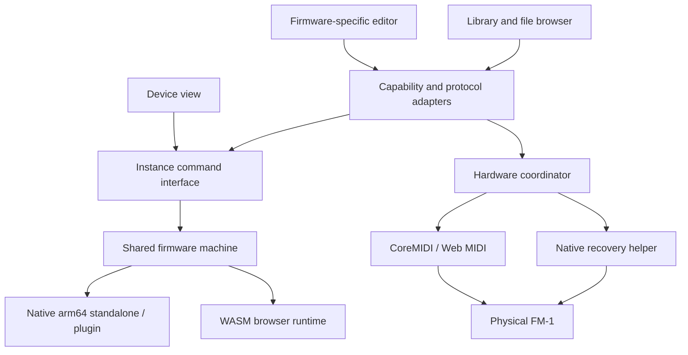

> Preserved research-phase document. See status.md for implementation progress and verification.

# FM-1 instrument and hardware companion specification

Version 0.1 — 2026-11-15. Research-informed proposal, ready for review; no implementation is implied.

## Intent agreed in the interview

Build a faithful software FM-1 that executes original official and community firmware binaries. Deliver a native Apple Silicon standalone instrument and VST3 plugin, plus a static browser application sharing the emulation engine. Provide both physical-device controls and an expanded editor/library/file browser. Prepare full hardware companion functionality before a device is available, and explicitly defer physical validation.

Primary machine: user-reported M5 Pro, 64 GB RAM, macOS Golden Gate 27.2. These are target details, not measured performance or compatibility results. Verify actual OS build, architecture, DAW versions and audio interface during implementation.

Personal use first; possible public open-source release later. Current deliverable is research and specification. Implementation, installation, forking and publishing are subsequent work.

### Initial scope

- Standalone and VST3; browser with the same core and main views where feasible.
- Original package loading, explicit version/hash identification, faithful sound and controls.
- Hardware-sized memory per instance, with a larger computer library for swapping content.
- MIDI input/output, MIDI-file playback, clock roles, host tempo/transport synchronization, multiple instances.
- Reliable DAW recall of firmware, memory, songs/patterns, settings and MIDI configuration, with preserved or explicitly reported dependencies.
- Hardware editing, MIDI, transfers, backup/restore and explicitly confirmed firmware installation.

### Later scope

Expanded emulated memory/storage, advanced MIDI mappings and host parameter automation, separate audio outputs, AAX, and fuller AU/Logic integration. Keep existing upstream AU buildability where practical without treating it as initial host acceptance. No Soundcraft research or integration is required.

Fully offline operation is confirmed for both native and browser versions after the app/site, chosen firmware and library dependencies have been saved locally. Discovery and updates are optional network operations. Playback, editing, recall, local import/export and library access must not depend on remote catalogs, fonts, scripts, firmware servers or account services.

## Product structure

One FM-1 instance contains one firmware machine and its own writable state. Native execution is arm64 without Rosetta, using the binary emulator/JIT. Browser execution uses WASM compiled from that same core. Neither route replaces firmware DSP with a recreated sound engine.

Proposed components:

The diagram describes logical boundaries; native and WASM are separate builds, not two successive execution layers. Recovery is a standalone/helper responsibility. A plugin can open its workflow, but must not perform privileged USB operations inside its audio process.

Use Rust core and native panel infrastructure from fm1-emu as the starting point. Retain the existing plugin framework before evaluating a rewrite. Native expanded UI should first fit the existing GUI stack; browser uses a web implementation with common command/data schemas. Adapting a web editor does not require embedding a browser in the audio plugin. Reassess shared UI technology after a small adapter prototype, based on latency, accessibility and maintenance.

## Compatibility contract

“Any firmware” means a firmware-agnostic loader and extensible hardware model, with support demonstrated for exact binaries. It cannot mean a guarantee for unknown instructions, hardware peripherals, future encrypted packages or unsupported dependencies.

Store each package unchanged, with SHA-256, source URL, author, declared version, board requirements, package contents and available license information. A firmware name alone is never an identity. Updates install alongside old versions and never silently replace the version used by a saved project.

Track independent statuses: package parsed; boots; controls work; audio works; saves persist; MIDI in; MIDI out; clock in/out; editor protocol; hardware transfer; hardware tested. Use labels such as upstream-documented, locally tested and physical-device verified. Catalog presence and boot screenshots cannot earn every status.

Unknown firmware must still offer Device view and opaque state/library management when it boots. Hide unsupported semantic operations with an explanation. Never display a SLOOP sequencer for an unidentified binary or infer write support from a matching product name.

On execution failure, retain the current library and original bytes. Show firmware hash, emulator version, failing subsystem and a locally generated diagnostic report. Do not silently launch a source port or approximate instrument.

## Device and editor views

Device view exposes all physical keys, buttons, encoders, MASTER, LEDs and the firmware’s framebuffer. Support press/release, held combinations, long presses, simultaneous keys, keyboard operation, zoom and focus recovery. Lost focus must release momentary controls to avoid stuck notes. Physical control events go through the emulated hardware interface.

Editor view is selected by firmware identity and negotiated protocol version. First adapters: stock/DX7 editing and SLOOP, followed by compatible Felucca-family versions as verified. Common pages: sound, sequencer, song, mixer, samples, library and device settings. Only offer pages that the active adapter implements.

Adapters describe types, ranges, units, slots, capabilities and supported migrations. Prefer the firmware’s published protocol and normal save commands. Avoid raw RAM patching as the default. If an expert operation modifies flash directly, require a version-specific layout and reversible snapshot, and run it with the machine stopped.

The same editor adapter should address an emulated USB endpoint or the physical hardware transport. This is a requirement to prototype, not an assertion that current upstream plugins already expose that endpoint. Host DAWs may not pass arbitrary SysEx; internal editor communication must not depend on host SysEx support.

## Library and storage

Native app and plugin instances share a library, but each working machine has independent memory. Use immutable content blobs, transactional metadata and atomic writes. A small database or equivalent indexed store records tags, favorites, firmware compatibility, dependencies and history. Browser persistence uses IndexedDB and/or origin-private storage with explicit export/import parity; it is separate from the native filesystem until the user exchanges files.

Object types must remain distinct:

| Object | Meaning | Import/export rule |
|---|---|---|
| Firmware package | Original installable firmware bytes | Preserve unchanged and hash. |
| Emulator persistent save | Package identity plus persisted device memory | Maintain upstream `.fm1save` interoperability where supported. |
| Running-machine snapshot | CPU/RAM/peripheral/runtime state | Emulator-versioned; never label as hardware-flashable. |
| Musical object | Patch, bank, sample, pattern, song/project | Firmware-specific codec; track required dependencies. |
| Full hardware backup | Device flash and device-specific metadata | Preserve privately; restore only through a validated hardware plan. |
| MIDI file | Timed musical events | Playback is universal input only to the extent firmware accepts the events; conversion into a device song is adapter-specific. |
| Rendered audio | Recorded instrument output | Standard WAV export for DAW/Audacity exchange. |

No automatic conversion between these categories based on extension alone. Unknown song/project formats can be stored as opaque files, but not advertised as editable or cross-firmware compatible.

The library can hold more content than hardware, bounded by disk/browser quotas. Loading content into an instance or device respects that firmware’s actual slots and sample budgets. Show destination slots, replacements and dependencies before transfer. Preserve sample originals alongside converted device data. No transparent sample streaming or memory enlargement in v1.

Operations: import, export, duplicate, tag, search, audition in an isolated instance, compare versions, inspect dependencies and restore a prior library revision. Never audition by overwriting the active DAW instance or connected hardware.

## DAW state and recall

A host project must retain or explicitly locate the exact firmware, flash, selected content, routing, channel settings, adapter version, clock settings and external dependencies. Instance-specific mutable state must not depend on the latest shared-library item.

Proposed recall design has two layers:

1. A portable persistent baseline: original firmware and its saved flash/content.
2. A versioned machine snapshot sufficient to preserve unsaved RAM, CPU registers, timers, DMA, peripheral state and pending events, taken at a consistent boundary.

A stopped instance is restored stopped; recalling a project never starts physical hardware or flashes anything. A snapshot may preserve musical position, but host transport remains authoritative in follower mode.

Full running-state serialization is an early feasibility gate. If the foundation cannot preserve unsaved state, surface that as a requirement gap before claiming complete recall. Falling back to “press Save in the firmware” changes the agreed experience and must be explicitly reviewed. Persisted firmware content and a resumable CPU snapshot are not the same guarantee.

Snapshot capture, compression, disk I/O and package parsing stay outside the audio callback. The audio callback must not wait for a worker to finish serializing. Host state requests must obtain a consistent current generation rather than an arbitrarily stale background copy. Validate freshness with a change immediately followed by project save and process termination.

Recall checks cover multiple independent instances, a changed/deleted library, missing firmware, emulator upgrades, failed migration, and cross native/browser persistent-save exchange. Store previous schemas and never overwrite the only recoverable copy during migration.

## MIDI and synchronization

Separate three paths: performance MIDI, editor/transfer SysEx, and emulated USB-controller transactions. Preserve channels and timestamps by default. Provide explicit input/output ports, channel handling, panic and loop prevention. An input event must not return to its source unless an explicitly selected thru route permits it.

Support MIDI notes, velocity, note-off, CC, program change, pitch bend and available pressure messages; real-time clock/start/continue/stop; and SysEx where the selected route permits it. Buffer variable-length SysEx outside the realtime callback with validated sizes, backpressure and a separate transfer queue. Busy transfers must not starve note-offs or transport.

Use one selected clock authority per instance:

| Mode | Authority and behavior |
|---|---|
| Internal | Firmware/local tempo; supported firmware may drive external MIDI clock. |
| Host follower | DAW tempo/transport mapped to timestamped MIDI clock and firmware-supported transport commands. |
| External follower | Chosen MIDI clock input; no competing host clock generator. |

Host follower mode generates clock at 24 PPQN in the sample timeline, independent of UI refresh. Start/continue/stop are mapped according to a tested firmware profile. Seeking, looping, song-position messages and tempo ramps need explicit policies. If firmware cannot seek, offer restart/retrigger or free-run behavior and disclose the limitation; do not imply arbitrary DAW timeline positioning is universally possible.

A firmware acting as clock master can send clock to other MIDI destinations. It must not be described as automatically controlling a DAW’s transport from inside VST3. DAW slaving is a separate host-dependent external-MIDI configuration.

### MIDI files: recommended combined approach

Offer **software-side playback** as the default general facility: parse standard MIDI files, retain tracks/channels/tempo maps, and schedule their events into the unmodified firmware. The firmware still produces the sound. Support SMF types 0 and 1 initially; explicitly reject or document other timing/types until implemented. On seek/stop/loop, clean up held notes, sustain and relevant controller state.

Also offer **firmware-native song import** through adapters where supported. This converts to device slots and may reduce length, polyphony or expressive data. Preview limits and losses. It is not the same operation as playing a MIDI file from the computer.

In host-sync mode, make the choice between file tempo and host tempo explicit. Do not run both clocks. A firmware without note input cannot be made into a MIDI-playable sound module by a generic file player. Preserve its own on-device workflow and explain unsupported routes. Do not inject replacement synthesis.

Silent controller/sequencer firmware must advance based on device/host time even when it emits no audio. MIDI output must be timestamped independently of the audio renderer. Never create a hidden synth solely to make such firmware run.

## Audio and Apple Silicon requirements

Native arm64 build and native core execution are required. Host/device sample-rate conversion happens after firmware output; increasing the host sample rate does not improve the firmware’s internal synthesis resolution. Preserve a direct reference path at the firmware output rate; evaluate a higher-quality resampler for other host rates against latency and spectral tests.

Run one isolated machine per instance with bounded realtime queues and explicit overflow reporting. Keep file I/O, network, transfer operations, parsing and UI work off the audio callback. Silence or controlled recovery on a machine fault must not corrupt another instance.

Measure latency as separate quantities: incoming event scheduling, emulator lookahead, firmware response, resampling delay and host/interface buffers. Report plugin-added latency correctly to the DAW; compensation does not remove live-monitoring delay. Do not lower emulated CPU clock silently to meet a latency target.

Initial benchmark matrix: 44.1/48/96 kHz hosts; 64/128/256/512-frame blocks; one, four and eight instances where sustainable. Proposed performance goal: no underruns in a 30-minute four-instance representative session at 48 kHz/128 frames on the target Mac. This is a goal to validate, not a promise. Publish heavy-firmware exceptions and measured live latency instead of one universal number.

Offline bounce, freeze, variable block size, host suspension, editor closure, reopening, sample-rate changes and transport jumps are acceptance cases. The current worker/lookahead design requires specific offline-rendering investigation; real-time playback success is insufficient.

Hardware sound-fidelity acceptance later compares matching firmware, flash, settings and event sequences. Compare digital output first where available, then analog output with recording-chain effects separated. Do not promise bit identity of random/generative outputs without controlled seeds and time.

## Physical hardware companion

Provide explicit Emulated / Hardware destination selection. Discovery must identify model and firmware where supported, then negotiate adapter capabilities. Unknown devices are not writable merely because they have an FM-1-like MIDI port name.

A native hardware coordinator owns access to a connected unit and serializes operations across standalone and plugin instances. Multiple instances can request data; only one transfer/install session may write a device at a time. Closing a plugin must not terminate a firmware write midway.

Keep live parameter editing, saved-content writes, full restore, firmware install and bootloader install separate. Firmware installation and bootloader replacement require explicit confirmation with device, source/target versions, affected regions and backup location. Routine editor gestures do not require repetitive confirmation.

Before destructive transfers: create a validated backup where the protocol permits it; determine board/chip/layout compatibility; show the exact write plan. Preserve calibration, keys and device-specific identity. Verify writes and report errors without blind retry loops. Stop/recovery behavior must reflect the underlying protocol’s actual safe interruption points.

Reusing M-Flasher as an external maintained tool is the initial recovery integration preference. Extracting a library can be evaluated later. Never require installing m-bootloader just to play the emulator, and never install it automatically as part of a firmware change.

Without hardware, implement transport interfaces, captured/synthetic protocol fixtures, simulated flash and disconnect/timeout tests. Mark physical operations **hardware verification pending**. No claim of successful transfer, restore, bootloader change or audio equivalence is allowed until performed on a real unit.

## Browser delivery

Serve static versioned assets over HTTPS or supported localhost hosting. Core emulation remains local; the browser app does not require an account or backend to play imported firmware. Use runtime feature detection rather than browser-name assumptions alone.

Provide an offline app shell through a service worker or an equivalently verified local installation. Cache all runtime assets and explicitly retain chosen firmware and library dependencies. Show which content is ready offline; a catalog entry alone is insufficient. Update caches transactionally, and never activate an incompatible runtime during an active musical session. Verify a fresh browser launch with networking disabled, rather than merely disconnecting an already-loaded page. Origin changes, cleared browser data and denied/evicted storage remain explicit recovery cases; downloaded backups must restore the library.

Device, editor, library and persistent-save import/export should match native semantics. Native file dialogs and browser downloads/pickers may differ. Storage quota failures must leave prior data intact; offer file backup and recovery. MIDI/SysEx permission is requested when the user chooses hardware/MIDI access, not simply on page load.

Do not claim browser access to native privileged USB recovery. Investigate m-bootloader’s MIDI backup/RAM-stage path as a separate transport capability. A browser limitation must not disappear from documentation simply because a native helper exists.

The browser has no DAW plugin host timeline by default; its clock modes are internal and external MIDI where supported. Test background-tab throttling, suspended AudioContexts, user gesture requirements and missing MIDI APIs. If a shared-memory design is introduced, document hosting header requirements and provide a supported fallback or explicit hosting contract.

## Distribution and maintenance

Keep upstream changes small and attributable, retain compatible save formats, and pin tested revisions and package hashes. Preserve notices per source file/component; firmware and bundled assets retain their own terms. Personal use does not automatically authorize redistributing downloaded firmware, samples or factory banks.

Native release packaging should support normal macOS launch/install behavior. Signing/notarization and JIT entitlements must be evaluated against the actual host and runtime; never assume enabling an app entitlement changes a DAW host’s permissions. No automatic Gatekeeper weakening belongs in the product.

The public-release decision requires a component/asset manifest based on pinned versions. MIT core code does not make GPL editor code or proprietary firmware MIT. Decide whether to adapt GPL components with their obligations or independently implement compatible protocol clients; do not accidentally relicense copied components.

## Decisions and remaining gates

Accepted: binary execution only; faithful-first; shared core; two UI modes; computer library with hardware-sized active memory; core MIDI and recall; full companion prepared without hardware; standalone/VST3 first.

Proposed: fm1-emu foundation; Rust native UI initially; firmware capability adapters; software MIDI-file playback plus optional native import; standalone recovery coordinator; snapshot-based volatile recall.

Unresolved gates: exact firmware compatibility, fast/strict timing fidelity, full snapshot completeness, silent MIDI firmware, offline rendering, actual M5/OS/DAW performance, adapter protocol coverage, browser backup route, and later hardware acceptance. Fully offline native/browser operation is a confirmed requirement. These are explicit engineering gates, not reasons to substitute a source-compiled instrument.
