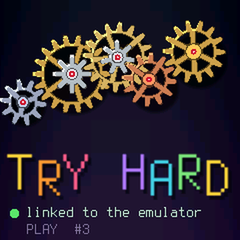

# Try Hard

**A real FM-1 as the emulator's front panel.** Try Hard is a firmware for the M-VAVE FM-1 that makes no sound: it
sends every key, button, encoder and the MASTER knob over USB-MIDI to [the emulator's page](https://joakimeriksson.github.io/fm1-emu/),
which plays the firmware it runs from them and sends its LEDs back. Play any firmware on the list with real keys and
knobs, without installing it. ([Issue #7](https://github.com/joakimeriksson/fm1-emu/issues/7).)

<p align="center"></p>

The screen is a clockwork: five axles of compound gears (a wheel and a pinion that turn together) on three
heights, flat and geometric, with outlines, spoked wheels and ruby jewels in the bearings. The teeth really mesh: each
pinion drives the next wheel at the ratio of their teeth, with phases that put a tooth in a gap
(`tests/mesh_test.c` turns the whole train and checks no two teeth ever overlap). Nothing moves by itself: the
encoders and MASTER turn it, half a tooth of the big wheel a detent, either way. It is drawn from tables made at boot
(every pixel's distance and angle from its axle), so a frame is lookups and compares, and only the clockwork is
redrawn; the words under it only when they change.

## Use it

1. Install it from the emulator's page ("A real FM-1 as the panel"), in Chrome or Edge, with the FM-1 on USB.
2. On the page, choose **FM-1 remote: Try Hard**, pick a firmware, press Start.
3. The FM-1 says *linked to the emulator*. Play.

Any other firmware installs over Try Hard as usual (the updater is Dinghy's: always there). Switching it on with
**OCT−** held is the USB rescue.

The messages: [PROTOCOL.md](PROTOCOL.md). Plain MIDI on channel 16, so a DAW can use it as a controller too.

## Build

Try Hard is one file, [firmware/tryhard.c](firmware/tryhard.c), on top of [Dinghy](https://github.com/rgrvmusic/fm1-dinghy)
(Felucca's platform, as SLOOP carries it: boot, USB, updates, the panel, the screen). `build.sh` fetches Dinghy at a
pinned commit, drops `tryhard.c` in as its app and gives the package its own identity, `FM-1_95N`.

```sh
try-hard/build.sh                 # -> try-hard/build/try-hard.fwsc (Linux x86-64, JieLi toolchain, AC79 SDK: Dinghy's README)
try-hard/build.sh --release 0.1   # identity FM-1_951, version 0.1 on the rescue screen
try-hard/build.sh --test          # the gears mesh (any C compiler)
try-hard/build.sh --host          # the screen as PNGs on this computer (CC, Python with Pillow)
try-hard/build.sh --host tests/host_script.txt 25   # ... a frame every 1/25 s, for a film
```

The site's workflow builds the package and puts it next to the installer (`tools/build_site.sh`).

## License

GPL-3.0-only ([LICENSE](LICENSE)), as Dinghy, Felucca and SLOOP. The platform is Copyright (C) 2026 Leo Kuroshita
(@kurogedelic), Hügelton Instruments, with SLOOP's changes (isod89) and Dinghy (zvenson). The installer
([web/](web/)) uses Felucca's update code (`fm1ota.js`, `fm1pkg.js`). The emulator around it is MIT; Try Hard is
its own program in its own directory, and the emulator's page only shows its installer in a frame.
